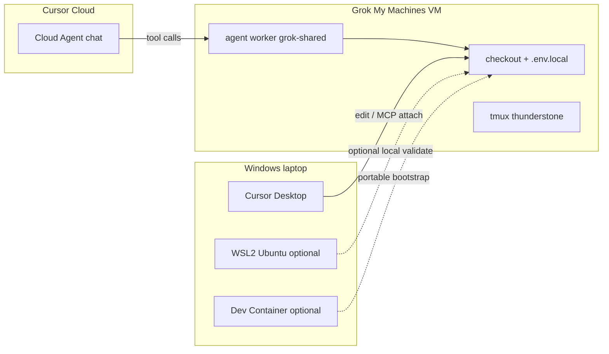

# Thunderstone local-dev + portable container stack

## Decisions (locked)

- **Target:** harden [thunderstone-starter](./) in place (no second clone).
- **Primary runtime:** **Grok / My Machines VM** (`CURSOR_WORKER_NAME=grok-shared`) — matches existing bridge in [docs/grok-vm/cursor-cloud-bridge.md](docs/grok-vm/cursor-cloud-bridge.md) and [scripts/cursor-worker.sh](scripts/cursor-worker.sh).
- **Portability layer:** add **Dev Container + GitHub Codespaces** so bootstrap is reproducible off-VM (laptop/Codespace) without replacing the VM worker model.
- **WSL2:** optional IDE sidekick only after tooling catch-up; not the source of truth for worker/Computer Use.

## Host comparison (what the probe showed)

| | **Grok / My Machines VM** | **WSL2 Ubuntu (this laptop)** | **Both (WSL IDE + VM worker)** | **Dev Container / Codespaces** |
|---|---|---|---|---|
| Role | Primary shell, git, tests, worker | Local Linux shell under Windows | Edit/chat on laptop; execute on VM | Portable identical Linux env |
| Fit for starter | Designed for this (`bootstrap.sh`, tmux, worker, optional Xfce) | Partial today | Best of both if VM stays online | Good for CI/onboarding; weak for My Machines desktop/CUA |
| Probe (2026-10-23) | N/A from this host (ops on VM) | Ubuntu 26.04 WSL2 **Stopped**; user `modme-agent`; **3 CPU / 6GB** (`.wslconfig`); disk ~1TB mostly free; repo visible at `/mnt/c/Users/dylan/projects/thunderstone-starter` | — | **∅** in repo today (no `.devcontainer/`) |
| Tool gaps | Run `doctor.sh` on VM | Missing: native `node`, `jq`, `rg`, `fzf`, `shellcheck`, `rclone`, `agent`; `npm` resolves to **Windows** Node; Docker Desktop path present but **WSL integration off**; `guiApplications=false` | Same WSL gaps + need healthy `grok-shared` worker | Image must install bootstrap toolset |
| Computer Use | Supported via `CURSOR_WORKER_COMPUTER_USE=1` + desktop | Weak (`guiApplications=false`) | CUA stays on VM | Usually no real desktop |
| Verdict | **Prefer** | Catch up later if you want local bash/`npm test` | Use when you want Windows Cursor UI + VM disk | Ship for portability; do not replace VM |

**Why prefer VM even with WSL present:** starter scripts assume Linux packages, `flock`/`tmux`, optional desktop, and outbound My Machines registration. WSL has memory capped at 6GB, no native Node 22, Docker integration off, and GUI off — so it is a second-class host until fixed. **Both** means: keep Cursor + MCP on Windows/WSL for chat and docs; route heavy `npm test` / patches / Computer Use through Cloud Agent → `grok-shared`.

## Architecture (from explorers)

Research: [Map starter bootstrap](4e09754c-4010-4c88-b99a-719a9f351cad), [Architect local agent stack](d570e3f2-d441-46c6-aa47-d643a50f9e02).

Five layers on one checkout:

1. **L0 Bootstrap** — `scripts/bootstrap.sh` → `doctor.sh` → `resume.sh` (on VM; Dev Container `postCreate` mirrors this with `SKIP_CURSOR_INSTALL` as needed).
2. **L1 Env** — `.env.local` via [scripts/env-run.mjs](scripts/env-run.mjs); keys from [.env.example](.env.example) + [config/cursor-worker.example.env](config/cursor-worker.example.env).
3. **L2 MCP (no duplicates)** — commit `config/dev-stack/mcp.example.json` → copy to gitignored `.cursor/mcp.json`.
   - **In mcp.json:** Context7 (`user-context7` / env-run + `CONTEXT7_API_KEY`), Caveman Cloud (`user-caveman-cloud`).
   - **Marketplace/product only (not mcp.json):** Composio plugin, Cursor Origin, Computer Use (+ worker flag).
   - Disable Context7 **plugin** when mcp.json Context7 is active (user MCP preference).
4. **L3 Skills** — keep `/caveman`, `/cursor-sdk`, `/agent-development`, `/orchestrate` as user/plugin skills; repo owns [.cursor/agents/collection-*.md](.cursor/agents/).
5. **L4 Collection** — investigator → implementer → verifier + [scripts/handoff-receipt.sh](scripts/handoff-receipt.sh); do not expand swarm until [tests/agent-collection-invariants.sh](tests/agent-collection-invariants.sh) stays green.
6. **L5 Fan-out** — My Machines worker on VM; Cloud Agent picks `grok-shared`.

## Implementation work (after plan approval)

### A. Portable container (new)

- Add `.devcontainer/devcontainer.json` + Dockerfile (or image features) that:
  - Installs bootstrap-required CLIs (bash, tmux, git, curl, jq, rg, fzf, python3, Node ≥22, shellcheck, make, flock).
  - Runs `npm ci` and documents `doctor.sh`.
  - Mounts/uses secrets via Codespaces secrets / env-run; never bake keys into image.
- Add `.github/workflows` or Codespaces metadata only if needed for `devcontainer` prebuild; keep thin.
- Document: Dev Container = portable validate/edit; **worker + Computer Use still on Grok VM**.

### B. Dev-stack MCP + docs

- Create `config/dev-stack/mcp.example.json` (mirror [config/browser/mcp.example.json](config/browser/mcp.example.json) pattern; Context7 + Caveman only; `node scripts/env-run.mjs …`).
- Create `docs/dev-stack/LOCAL-DEV.md`: VM primary, WSL probe notes, Dev Container, MCP duplicate policy, host comparison.
- Extend `.env.example` with `CONTEXT7_API_KEY=` (name only).
- Cross-link from [AGENTS.md](AGENTS.md) and [docs/grok-vm/cursor-cloud-bridge.md](docs/grok-vm/cursor-cloud-bridge.md).

### C. Operator steps on Grok VM (no code)

1. Clone/update starter on VM durable disk.
2. `sh scripts/bootstrap.sh` → `.env.local` → `agent login` or `CURSOR_API_KEY`.
3. `bash scripts/resume.sh`; `CURSOR_WORKER_AUTOSTART=1` or `cursor-worker.sh start`.
4. `cp config/dev-stack/mcp.example.json .cursor/mcp.json` (or attach same MCPs in Cloud UI).
5. Enable Composio plugin + Origin + Computer Use in Cursor product settings; set `CURSOR_WORKER_COMPUTER_USE=1` only if desktop automation needed.
6. Cloud Agent → repo `Ditto190/thunderstone-starter` → My Machines → `grok-shared`.
7. Gate: `doctor.sh`, `cursor-worker.sh status`, `npm test`.

### D. Optional WSL catch-up (deferred unless you ask)

- Enable Docker Desktop → WSL integration for `Ubuntu`.
- Install native Node 22 + missing CLIs inside WSL (not Windows PATH).
- Prefer Linux FS clone (`~/src/thunderstone-starter`) over `/mnt/c/...` for `npm test` speed.
- Leave `guiApplications` off unless you need local GUI; CUA stays on VM.

### E. Collection execution order

1. **collection-investigator** — brief: “dev-stack MCP + Dev Container + LOCAL-DEV runbook”.
2. **collection-implementer** — patch A+B on a branch; `npm test`.
3. **collection-verifier** — `handoff-receipt.sh check-promotion`; open PR.

## Out of scope

- Replacing Drive/GitHub ownership split.
- Adding parallel agents beyond baseline collection.
- Inventing Caveman MCP binary names without Context7/docs confirmation at implement time.
- Auto-approving MCP/shell, pushes, or remote deletes.
